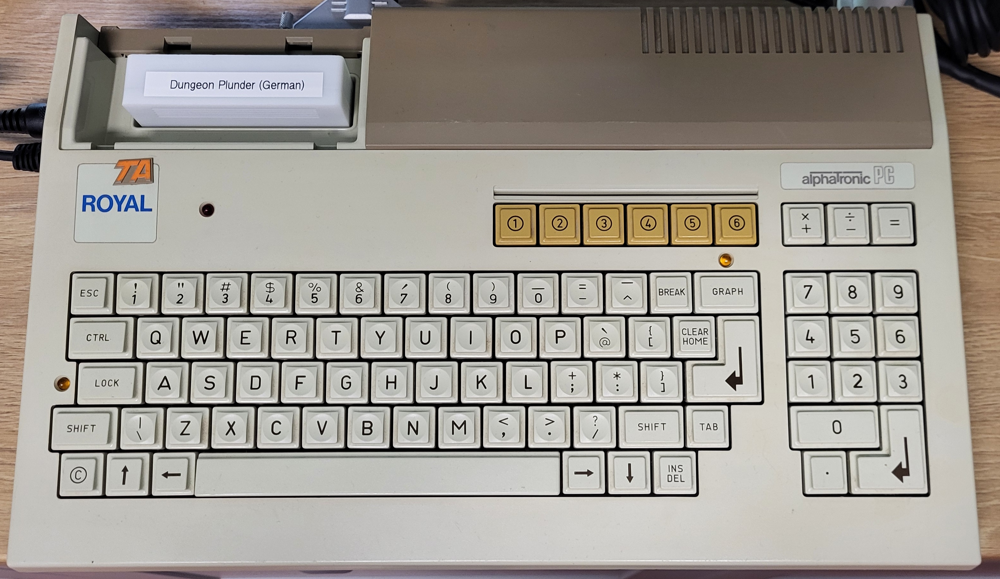
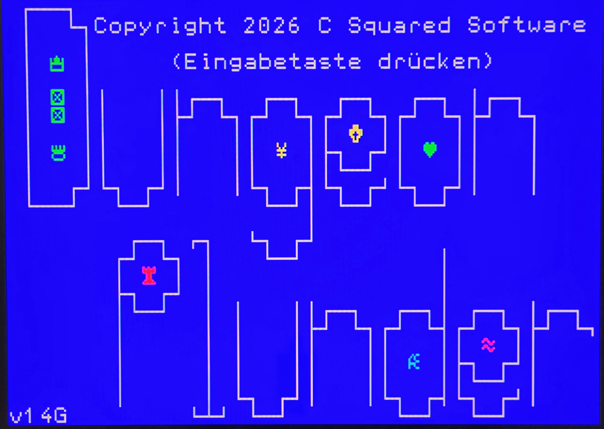
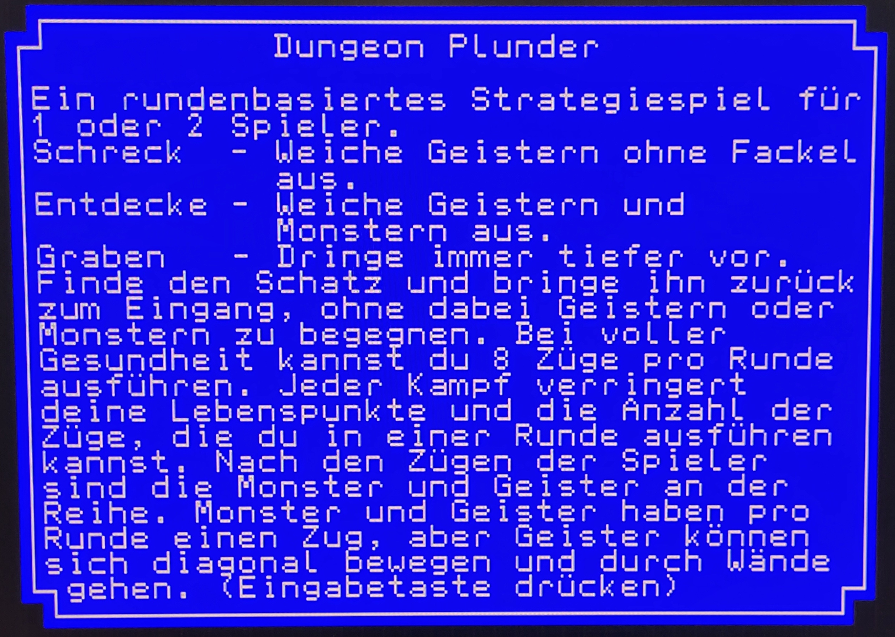
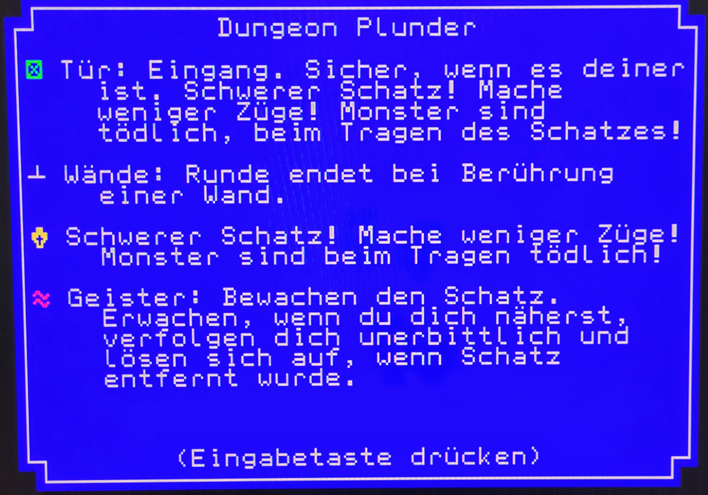
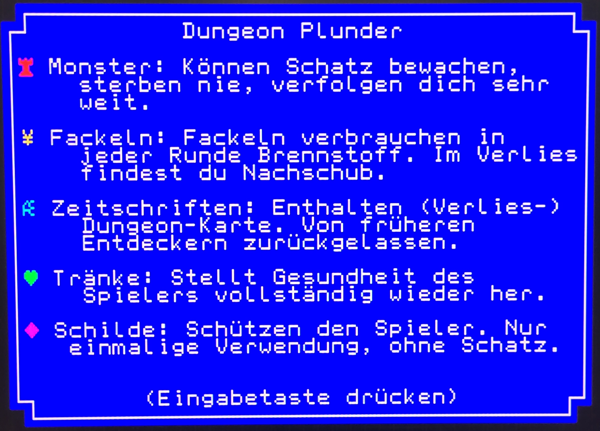
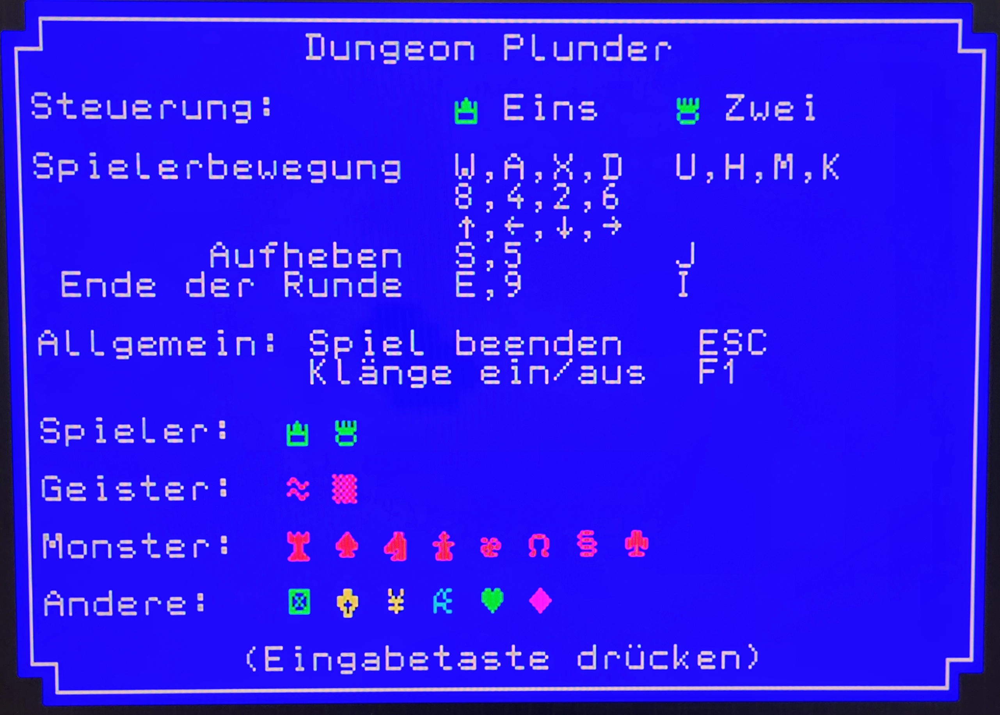
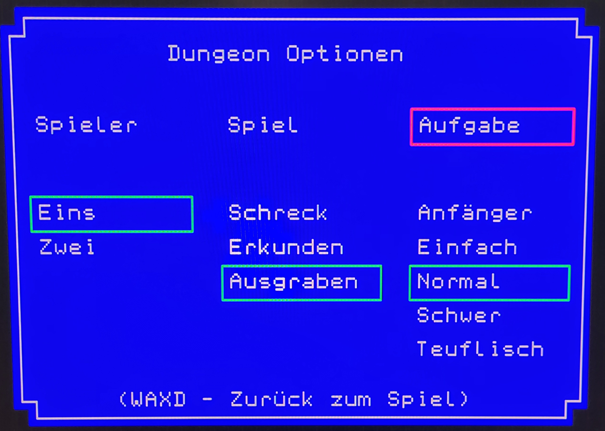
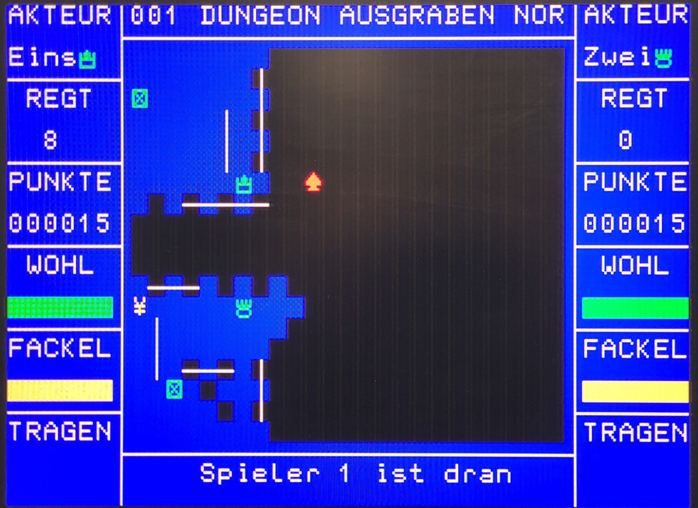
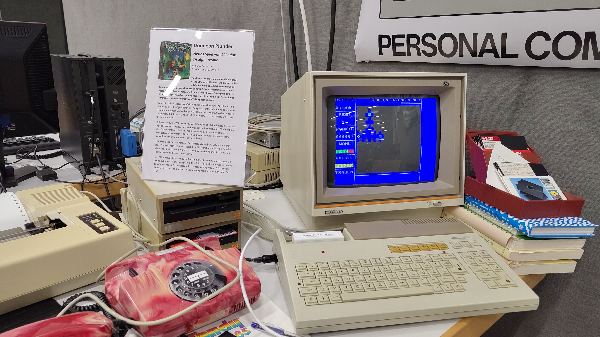

# Dungeon Plunder for the Triumph Adler Royal Alphatronic PC (8)

\
\
Developed as a stand alone, 16K game cartridge. Available in English and German.
\
\
Binary file assembled for Eprom(s) from 0xA000 to 0xDFFF.
\
\
Demo Computer:\

\
\
Welcome Screen:\

\
\
Instructions:\

\
\
Options:\

\
\
Gameplay:\

\
\
Classic Computing 2026, Celle, Germany.\
Jürgen Wich demonstrating Dungeon Plunder on the Triumph Adler Alphatronic PC.\
Classic Computing 2026 Demo\
[CC2026 in English](https://youtu.be/AFQWB5P_sC4?t=386)\
[CC2026 in Deutsch](https://www.youtube.com/watch?v=tx9PPumDHLQ&t=385s)

