# Dungeon Plunder for the SORD M5

\
Welcome Screen:\
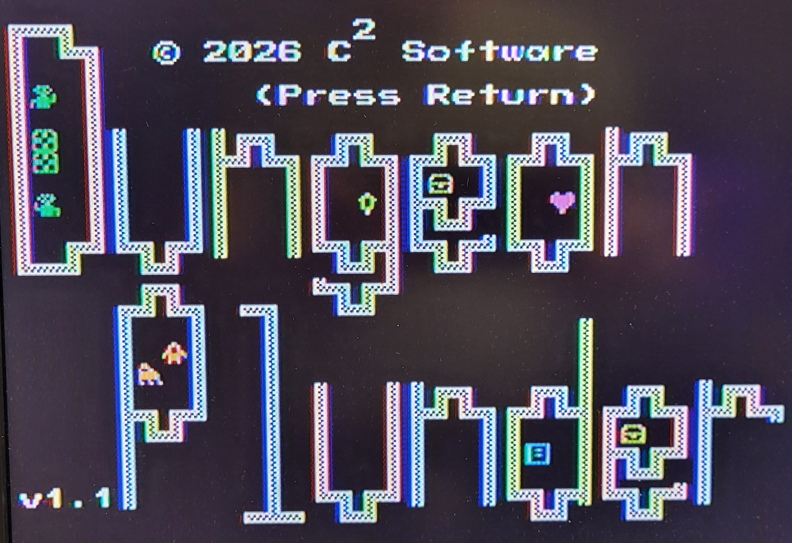
\
\
Instructions:\
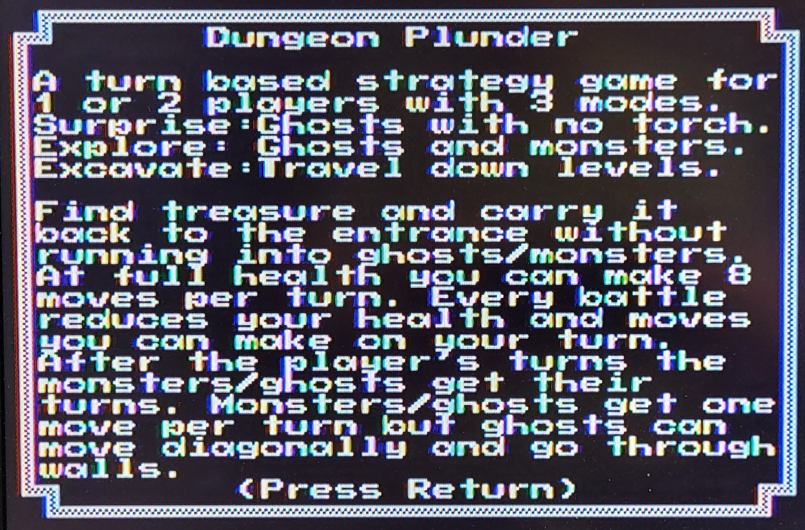
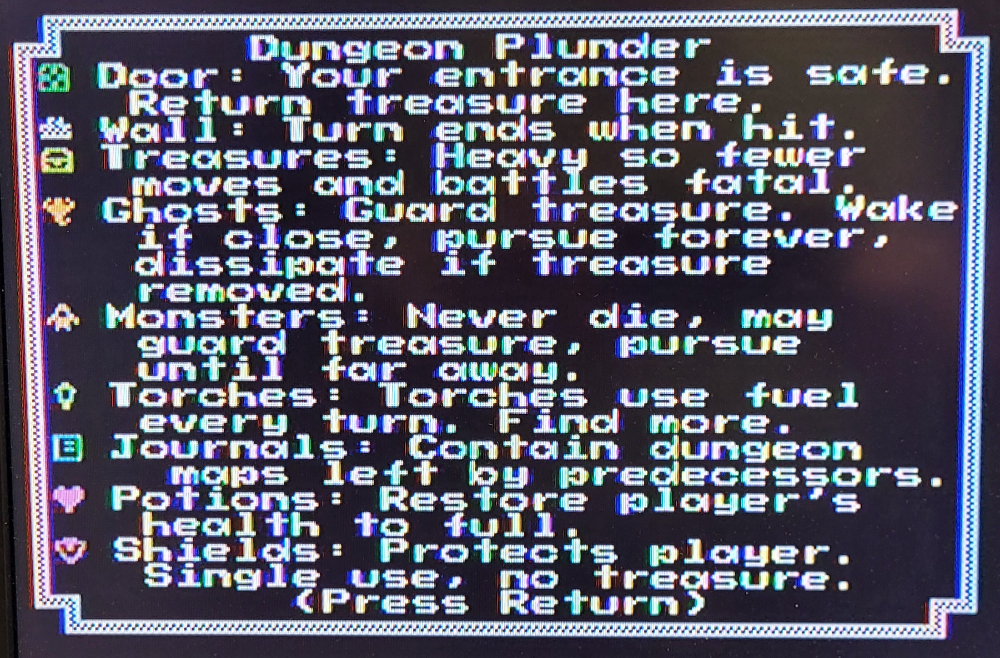
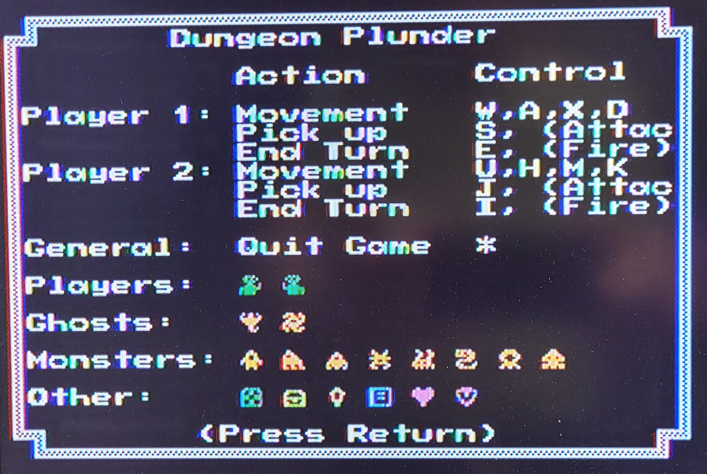
\
\
Options:\
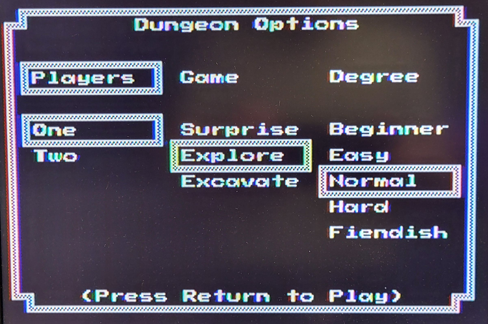
\
\
Gameplay:\
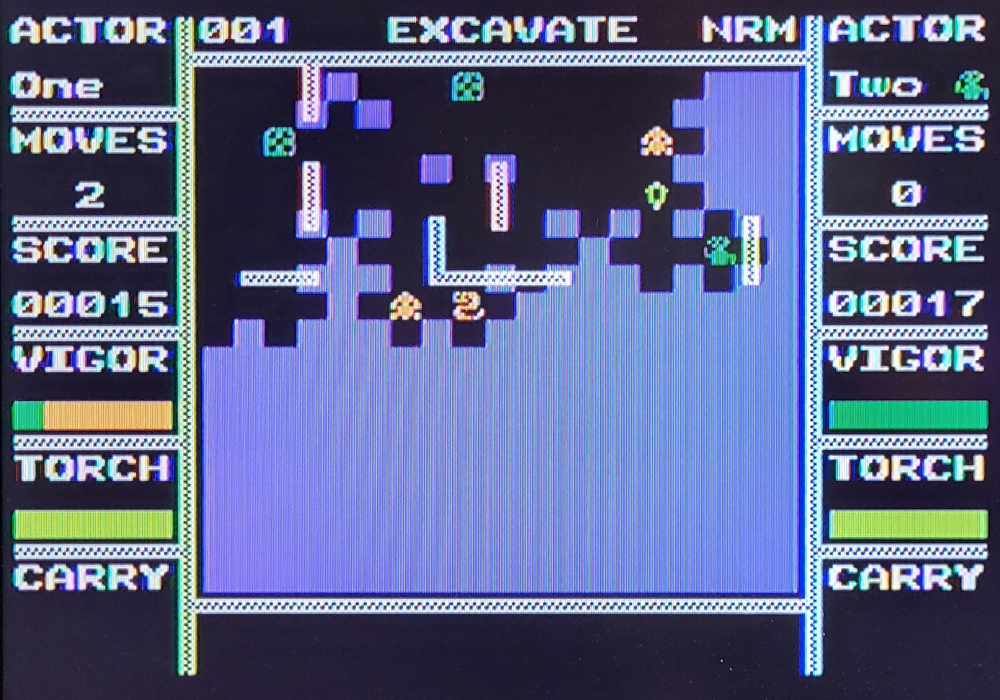
\
\
The Easter Eggs from the ColecoVision version are included.\
\
Easter Egg - Sound Composer:\
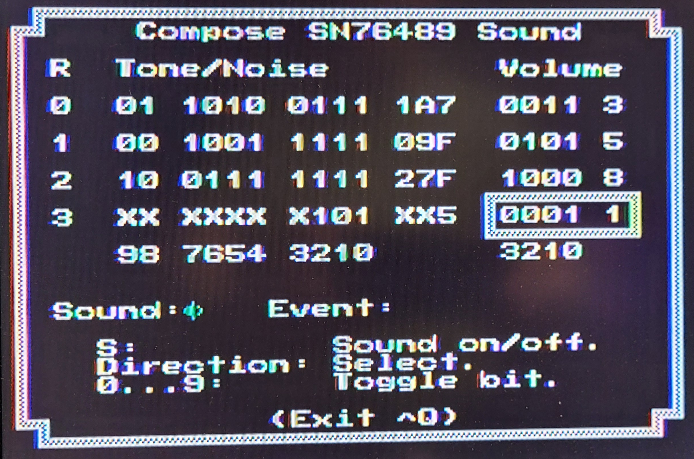
\
\
Easter Egg - Controller Tester:\
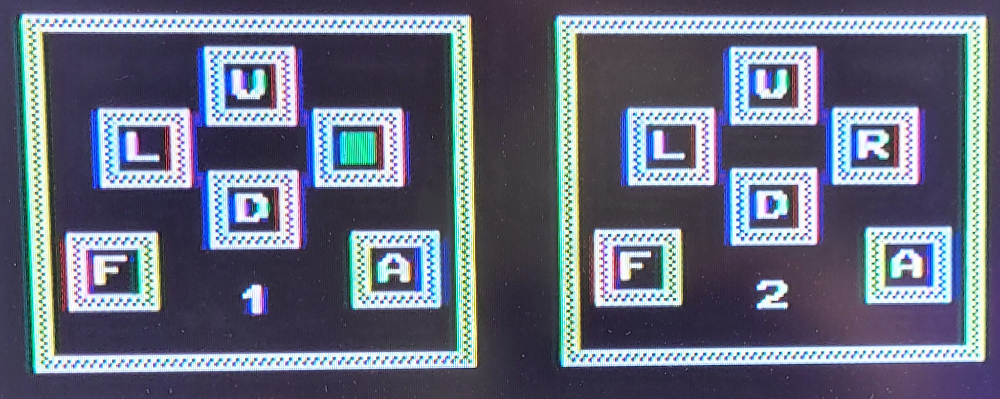
\
\
Easter Egg - Colour Tester:\
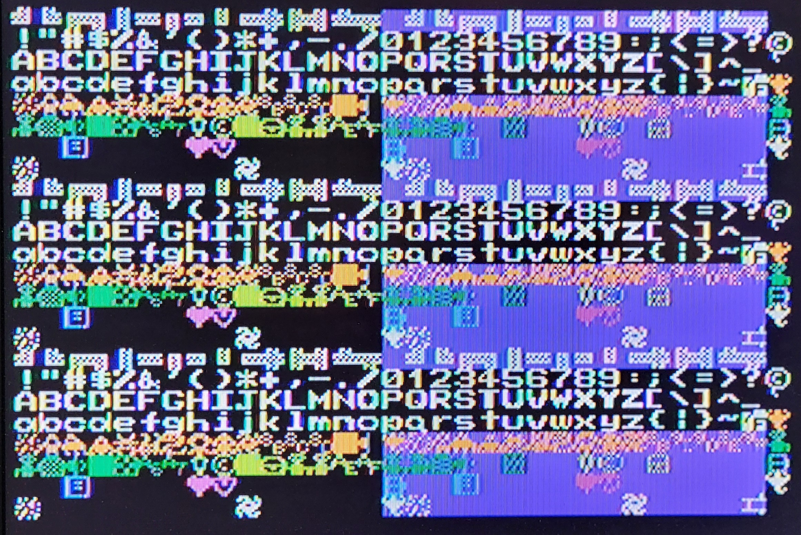
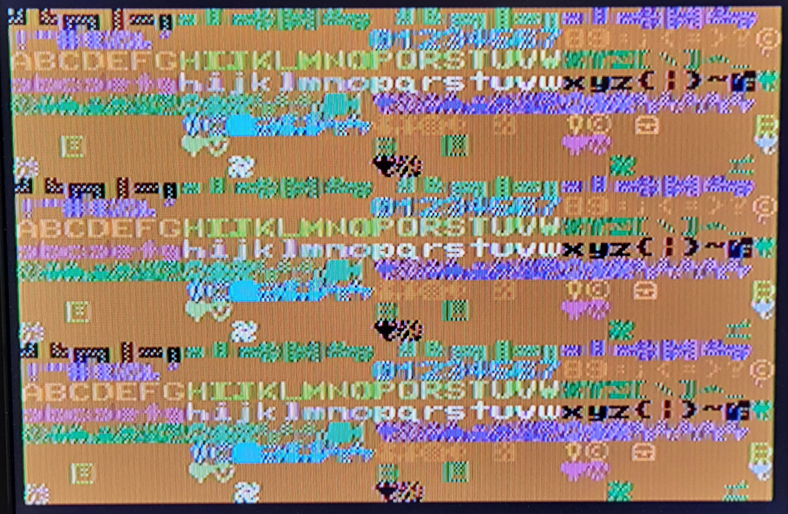
\
\
Just for fun the "Debug Modes" of the original version were reinstalled.\
\
Debug - Show. Showing where everything is hidden. (Ultimate cheat mode.)
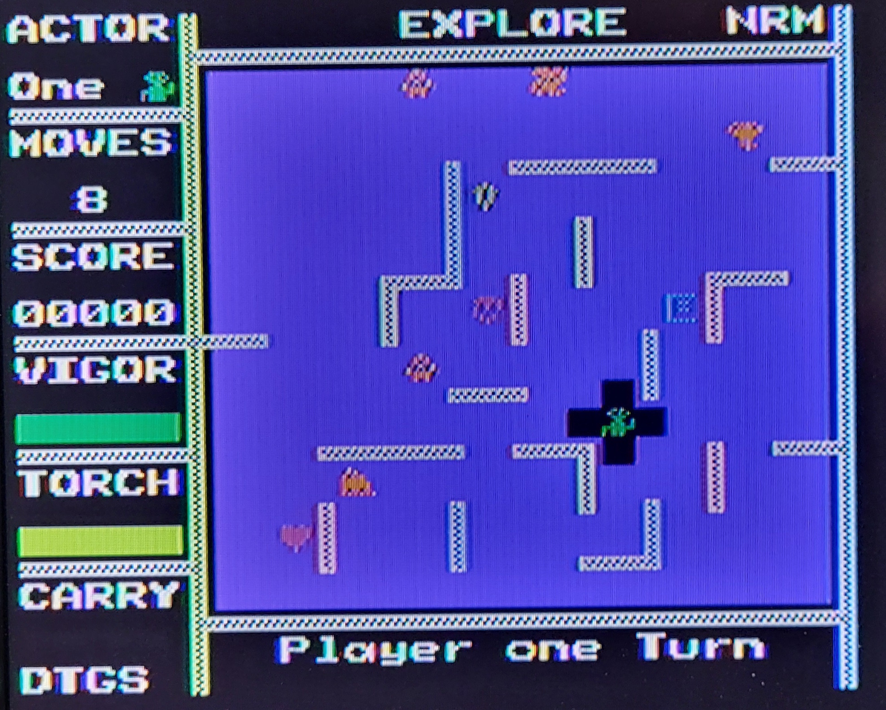
\
\
Debug - Search. Showing the shortest path search between monster and player.
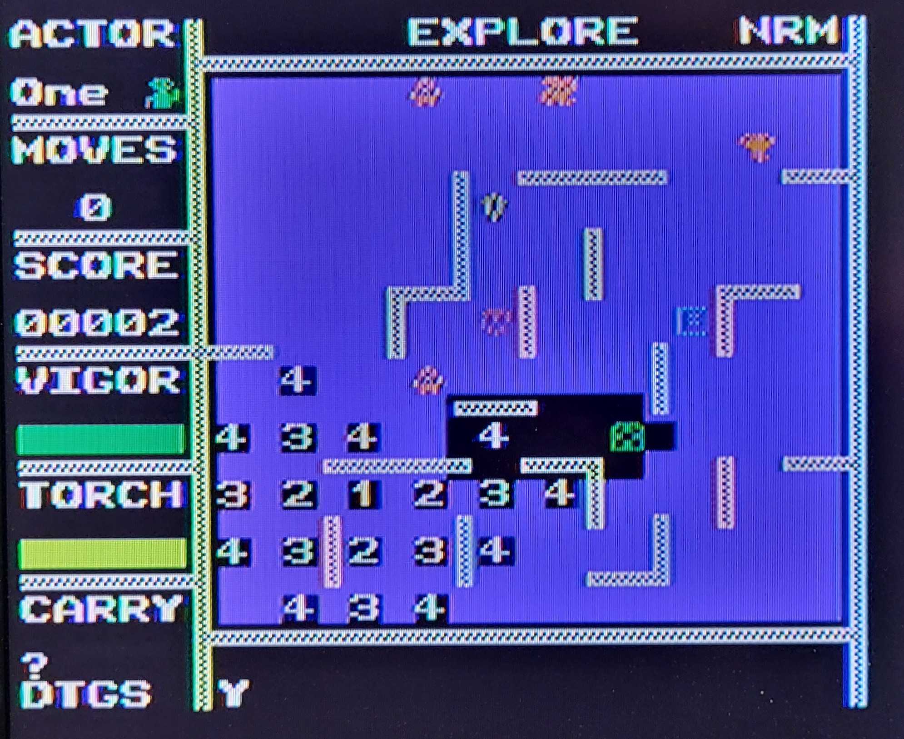
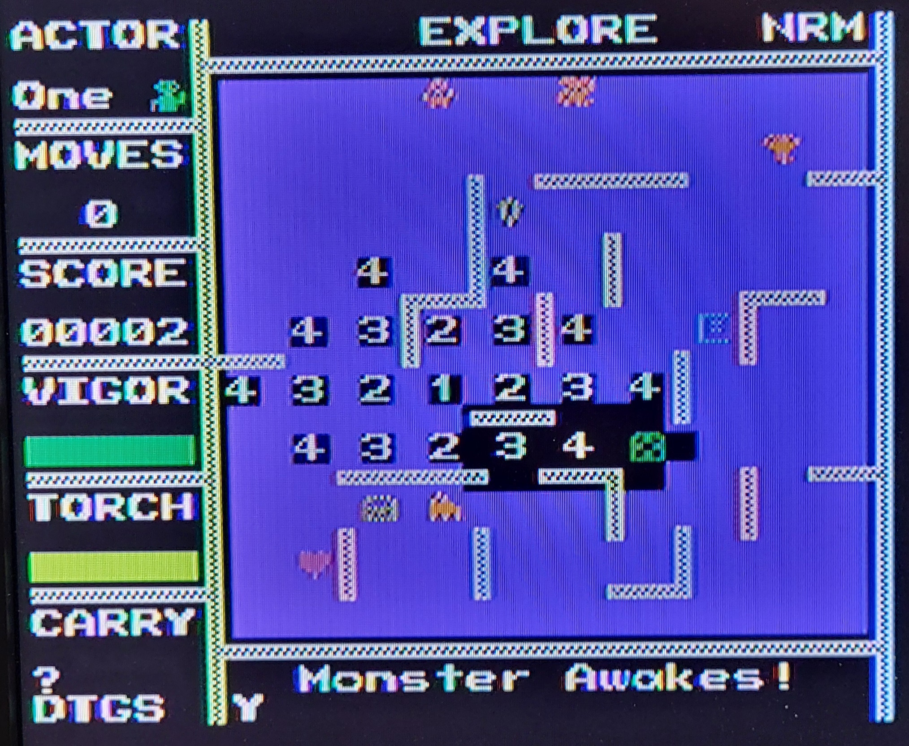
\
\
The test console: (With homebuilt power supply and flexicard.)\
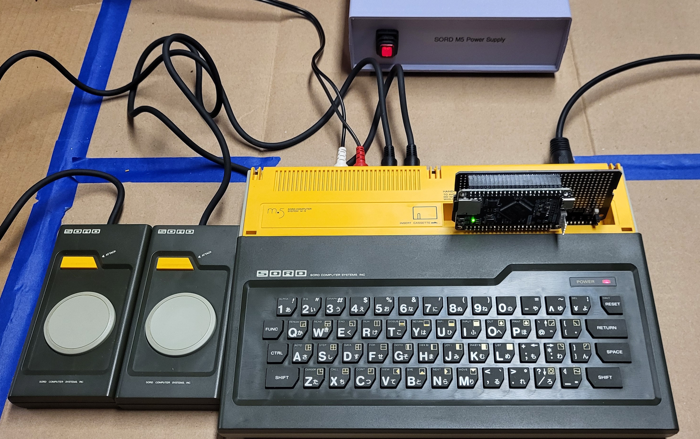
\
\
The flexicard:
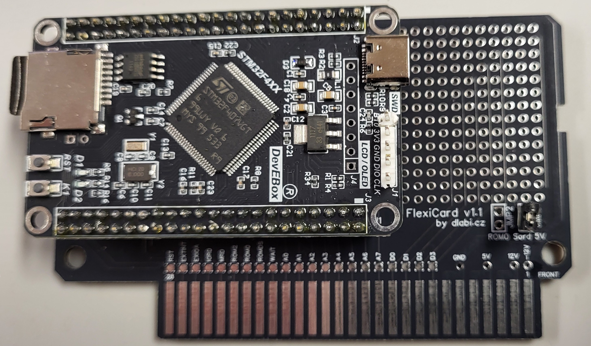
\
Note: The flexicard was built using these instructions.\

